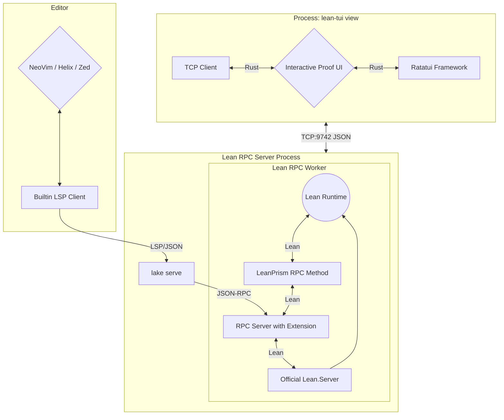

# Contributing

This is a more in-depth guide for advanced users or contributors.

## Previous Work

For the **VS Code users**: Yes, the official info view endorsed by the Lean organization is written for VS Code. However, I don't like VS Code and vendor lock-in. We should all try to move away from any Microsoft-owned product as soon as possible. Why? Take a look at for example ["Embrace, extend, and extinguish"](https://en.wikipedia.org/wiki/Embrace,_extend,_and_extinguish) but also the recent news.

For the **Neovim users**, yes there existed an info view [Lean plugin for Neovim](https://github.com/Julian/lean.nvim) already, but not yet for the other terminal editors (Zed, Kakoune, Helix, ...) since the Lean plugin relies on Neovim specific features. It is not a generic one.

## How Does It Work?

This is mainly a front for [**lean-prism**](https://codeberg.org/wvhulle/lean-prism), a custom LSP server that adds an RPC method on top of the built-in LSP-compliant RPC methods provided by Lean's LSP. The additional RPC methods uses Lean's internal APIs to extract detailed proof information (tactic applications, goal transformations, go-to locations) that isn't available through standard LSP.

The name `lean-prism` comes from showing proof state through different "prisms" or perspectives - the various graph and visualization modes that let you examine your proofs from different angles.



## Debugging

If you see errors in the editor like "incompatible headers", you can try

1. Close both the TUI view and the LSP client and restart.
2. Rebuilding `lean-prism`

If that does not help, follow along with the logs while reproducing the bug (and paste the output in a bug report):

```bash
tail -f ~/.cache/lean-tui.log # TUI front-end (for debugging the Ratatui-side)
```

Some editors also have debug logs for the LSP client. For Helix:

```bash
tail -f ~/.cache/helix/helix.log
```

## Development

Don't forget to update the commit hash in `build.rs` when the JSON schema changes upstream.

### Regenerating Screenshots

The GIFs in `screenshots/` are recorded in the Nix sandbox by `lean-tui-recordings` (`tests/recordings/`): it runs Helix and `lean-tui` in two pseudo-terminals, composes them side by side, and writes an asciicast with fixed frame durations, which agg renders to GIF. Frames are only taken once the screen has settled, so the GIFs are reproducible.

```bash
nix build .#demos && cp --no-preserve=mode result/*.gif screenshots/
```

Each scene is its own derivation (`.#demo-semantic_tableau`, `.#demo-data_flow`, ...), so Nix records them in parallel. Scenes live in `tests/recordings/src/scenes/`, one file per scene, registered in `tests/recordings/src/scenes.rs`; the file name is the scene name.

Woodpecker on Codeberg runs `nix flake check` on every push and pull request (`.woodpecker/check.yaml`). On version tags (`v*`) or a manual run, `.woodpecker/screenshots.yaml` re-records the GIFs and commits changed ones to `main` as `docs: regenerate screenshots [skip ci]`; it needs a Woodpecker secret `codeberg_token` (a Codeberg access token with repository write access).

The test projects live in `tests/`:

- `tests/samples/`: the Lean files shown in the README and recordings.
- `tests/lean-dev/`: Lake project for co-developing against a sibling `../lean-prism` checkout (with Mathlib).
- `tests/recordings/lean/`: Lake project with `LeanPrism` pinned in `lake-manifest.json` (update with `lake update` inside that directory); the flake also takes the protocol schema for the Nix build of `lean-tui` from that revision.

To iterate on a scene outside Nix, run it from `tests/recordings/lean/` with `hx`, `agg`, `gifsicle` and a built `lean-tui` on the `PATH`:

```bash
cargo run --release -p lean-tui-recordings -- record --out /tmp/recordings --font-dir <dir with JetBrains Mono> semantic_tableau
```
