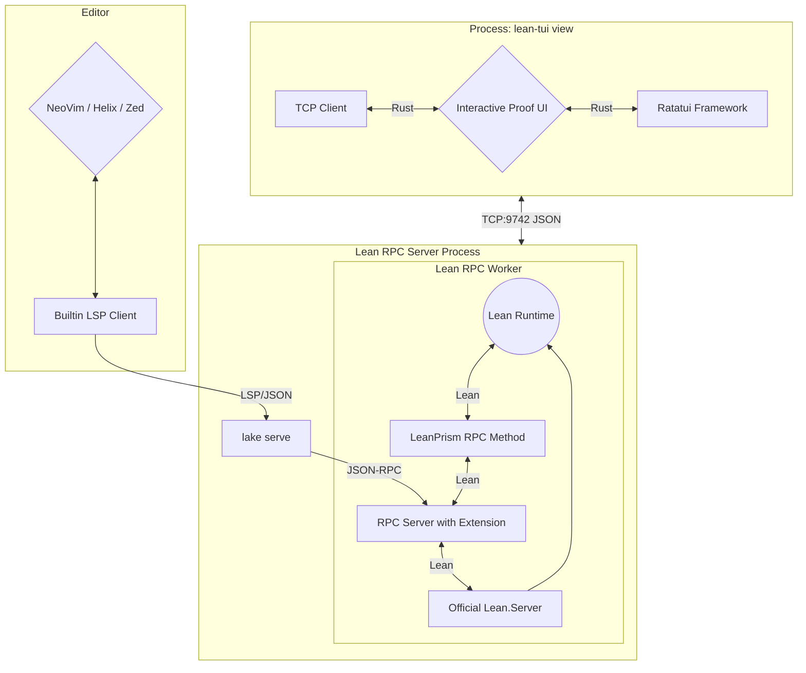

# Contributing

This is a more in-depth guide for advanced users or contributors.

## Previous Work

For the **VS Code users**: Yes, the official info view endorsed by the Lean organization is written for VS Code. However, I don't like VS Code and vendor lock-in. We should all try to move away from any Microsoft-owned product as soon as possible. Why? Take a look at for example ["Embrace, extend, and extinguish"](https://en.wikipedia.org/wiki/Embrace,_extend,_and_extinguish) but also the recent news.

For the **Neovim users**, yes there existed an info view [Lean plugin for Neovim](https://github.com/Julian/lean.nvim) already, but not yet for the other terminal editors (Zed, Kakoune, Helix, ...) since the Lean plugin relies on Neovim specific features. It is not a generic one.

## How Does It Work?

This is mainly a front for [**lean-prism**](https://codeberg.org/wvhulle/lean-prism), a custom LSP server that adds an RPC method on top of the built-in LSP-compliant RPC methods provided by Lean's LSP. The additional RPC methods uses Lean's internal APIs to extract detailed proof information (tactic applications, goal transformations, go-to locations) that isn't available through standard LSP.

The name `lean-prism` comes from showing proof state through different "prisms" or perspectives - the various graph and visualization modes that let you examine your proofs from different angles.



## Debugging

If you see errors in the editor like "incompatible headers", you can try

1. Close both the TUI view and the LSP client and restart.
2. Rebuilding `lean-prism`

If that does not help, follow along with the logs while reproducing the bug (and paste the output in a bug report):

```bash
tail -f ~/.cache/lean-tui.log # TUI front-end (for debugging the Ratatui-side)
```

Some editors also have debug logs for the LSP client. For Helix:

```bash
tail -f ~/.cache/helix/helix.log
```

## Development

The protocol types are generated from `protocol-schema.json` in lean-prism. `build.rs` reads the file named by `LEAN_DAG_SCHEMA`, which `nix build` and `nix develop` set from the `lean-prism` flake input (lean-prism's `main`). That input is the only pin. To pick up a protocol change:

```bash
nix flake update lean-prism
```

A `cargo` build outside the devshell needs `LEAN_DAG_SCHEMA` pointing at a checkout of lean-prism's `protocol-schema.json`.

The flake is split by concern: `nix/` builds, checks and releases the Rust crate, and `recordings/` holds everything that needs Lean.

### Releases

Releases are automated with [release-plz](https://release-plz.dev/) on Woodpecker, so write [conventional commits](https://www.conventionalcommits.org/) (pull requests are checked with `convco`).

- `.woodpecker/checks.yaml` builds the crate and runs the tests and `rustfmt`. It never needs Lean.
- `.woodpecker/release.yaml` runs on every push to `main`: it publishes a bumped version to crates.io, tags it and creates the Codeberg release, then opens or updates a release pull request with the next version and changelog. Merging that pull request triggers the next release. `feat`, `fix` and `perf` commits trigger a release; other types only appear in the changelog.
- `.woodpecker/binaries.yaml` builds static musl binaries (`nix build .#dist`) and attaches them to each Codeberg release.

The Woodpecker repository needs the secrets `codeberg_token` (repository write access), `cargo_registry_token` (crates.io publish token for `lean-tui`) and `cachix_auth_token` (push access to `wvhulle.cachix.org`).

### Regenerating Screenshots

The GIFs in `screenshots/` are recorded with [VHS](https://github.com/charmbracelet/vhs) tapes in `recordings/tapes/`: each `<scene>.tape` opens Helix and `lean-tui` side by side in tmux (shared setup in `open.tape`, shared settings in `common.tape`) and plays the keystrokes.

```bash
nix build .#recordings && cp --no-preserve=mode result/*.gif screenshots/
```

Each tape is its own derivation (`.#recording-semantic_tableau`, `.#recording-data_flow`, ...), so Nix records them in parallel and only re-records tapes whose inputs changed. To add a scene, add a `<scene>.tape` next to the others.

On every push to `main` that touches the crate (`src/`, `build.rs`, `Cargo.*`, `flake.lock`, `nix/package.nix`, `nix/toolchains.nix`) or `recordings/`, `.woodpecker/screenshots.yaml` builds the recordings (and with them the Lean project), pushes them to `wvhulle.cachix.org`, and commits changed GIFs to `main` as `docs: regenerate screenshots [skip ci]`. Because unchanged recordings come from the cache, they keep the same bytes and are not committed again. It needs two Woodpecker secrets: `cachix_auth_token` (push access to the `wvhulle` cache) and `codeberg_token` (a Codeberg access token with repository write access).

The Lean projects:

- `recordings/`: Lake project with `LeanPrism` pinned in `lake-manifest.json` (update with `lake update` inside that directory). `recordings/Samples/` holds the Lean files shown in the README and recordings, `recordings/tapes/` the VHS tapes.
- `tests/lean-dev/`: Lake project for co-developing against a sibling `../lean-prism` checkout (with Mathlib). Its `Samples` links to `recordings/Samples`.
