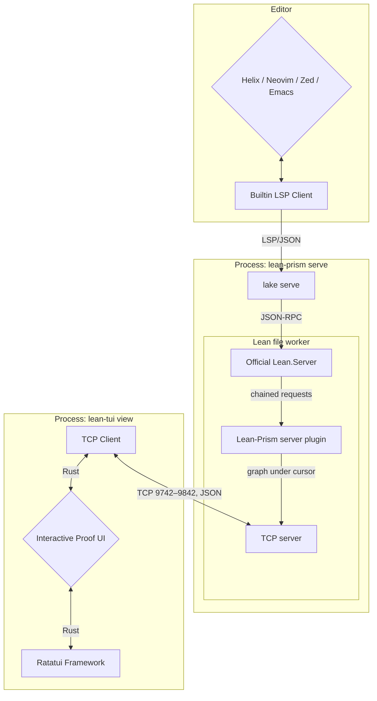

# Contributing

This is a more in-depth guide for advanced users or contributors.

## Previous Work

For the **VS Code users**: Yes, the official info view endorsed by the Lean organization is written for VS Code. However, I don't like VS Code and vendor lock-in. We should all try to move away from any Microsoft-owned product as soon as possible. Why? Take a look at for example ["Embrace, extend, and extinguish"](https://en.wikipedia.org/wiki/Embrace,_extend,_and_extinguish) but also the recent news.

For the **Neovim users**, yes there existed an info view [Lean plugin for Neovim](https://github.com/Julian/lean.nvim) already, but not yet for the other terminal editors (Zed, Kakoune, Helix, ...) since the Lean plugin relies on Neovim specific features. It is not a generic one.

## How Does It Work?

This is mainly a front for [**lean-prism**](https://codeberg.org/wvhulle/lean-prism). `lean-prism serve` runs `lake serve` with a Lean-Prism server plugin built for the project's Lean version. The plugin chains onto the hover, document highlight, completion and goal requests of Lean's language server and uses Lean's internal APIs to extract proof information (tactic applications, goal transformations, go-to locations) that isn't available through standard LSP. Every file worker serves the graph under the cursor over TCP on its own port in 9742–9842; lean-tui scans the first ports of that range.

The name `lean-prism` comes from showing proof state through different "prisms" or perspectives - the various graph and visualization modes that let you examine your proofs from different angles.



## Debugging

See [troubleshooting](docs/setup.md#troubleshooting). When reporting a bug, run `lean-tui --verbose` and attach `~/.cache/lean-tui.log` (and your editor's LSP log, for Helix `~/.cache/helix/helix.log`).

## Development

The protocol types are generated from `protocol-schema.json` in lean-prism. `build.rs` reads the file named by `LEAN_DAG_SCHEMA`, which `nix build` and `nix develop` set from the `lean-prism` flake input (lean-prism's `main`). That input is the only pin. To pick up a protocol change:

```bash
nix flake update lean-prism
```

A `cargo` build outside the devshell needs `LEAN_DAG_SCHEMA` pointing at a checkout of lean-prism's `protocol-schema.json`.

The flake is split by concern: `nix/` builds, checks and releases the Rust crate, and `demos/` holds everything that needs Lean.

Product tasks such as recording scenes and generating docs are Rust subcommands of the `xtask` crate, run with `cargo xtask <task>` (`cargo xtask --help` lists them). Nix wraps the ones CI needs with their runtime tools in `nix/xtask-tool.nix`.

CI tasks are Nushell scripts in `ci/`, exposed as flake apps by `nix/ci.nix`, and workflows hold no shell logic. They also work locally where the variables they read are set:

| Command | Purpose |
|---------|---------|
| `nix run .#check-commits -- main..@` | Conventional commit message check for a revision range |
| `nix run .#release` | Publish an unreleased version to crates.io and create its tag and Codeberg release (CI only, needs `CODEBERG_TOKEN`) |
| `nix run .#release-pr` | Open or update the release PR (CI only, needs `CODEBERG_TOKEN`) |
| `nix run .#collect-release-archives -- <result> <dist>` | Copy the archives of a build result into a release directory |
| `nix run .#upload-release-assets -- <dist>` | Checksum the archives in a release directory and attach them to the Codeberg release (CI only, needs `CODEBERG_TOKEN`) |
| `nix run .#build-unless-cached -- <installable>` | Build and export an output unless it is already in Cachix (needs `CI_WORKSPACE`) |
| `nix run .#build-and-export-paths -- <installable>` | Build and export newly built paths to the workspace for later steps (needs `CI_WORKSPACE`) |
| `nix run .#import-exported-paths` | Import paths exported by an earlier step (needs `CI_WORKSPACE`) |
| `nix run .#upload-exported-paths` | Push the exported paths to Cachix (needs `CI_WORKSPACE` and `CACHIX_AUTH_TOKEN`) |

`docs/keybindings.md` is generated from `src/keybindings.rs`. After changing a keybinding, run `cargo xtask keybinding-docs`; the `keybinding-docs` flake check fails when the file is out of date.

### Releases

Releases are automated with [release-plz](https://release-plz.dev/) on Woodpecker, so write [conventional commits](https://www.conventionalcommits.org/) (pull requests are checked with `convco`).

- `.woodpecker/checks.yaml` builds the crate, runs the tests, `rustfmt` and the CI task tests, and checks that `docs/keybindings.md` is up to date, each in its own step. The Cargo dependencies come first in their own step. Pushes upload newly built paths to Cachix in a separate step; pull requests run the same steps without the upload. It never needs Lean.
- `.woodpecker/release.yaml` runs on every push to `main`: it publishes a bumped version to crates.io, tags it and creates the Codeberg release, then opens or updates a release pull request with the next version and changelog. Merging that pull request triggers the next release. `feat`, `fix` and `perf` commits trigger a release; other types only appear in the changelog.
- `.woodpecker/binaries.yaml` builds static musl binaries (`nix build .#dist`) and attaches them to each Codeberg release.

The Woodpecker repository needs the secrets `codeberg_token` (repository write access), `cargo_registry_token` (crates.io publish token for `lean-tui`) and `cachix_auth_token` (push access to `wvhulle.cachix.org`).

### Demos

Every folder in `demos/` is one demo: a Lean sample, the VHS tapes that record it and the replay fixture used by the snapshot tests. The recorded WebP animations are not part of `main`: they live as the single commit of the orphan `recordings` branch, so the history of `main` stays free of media, and the README and docs embed them from `https://codeberg.org/wvhulle/lean-tui/media/branch/recordings/<demo>/<scene>.webp`.

```
demos/
  default.nix  lakefile.toml  lean-toolchain  .helix/   Lake project and Nix recording setup
  common.tape  open.tape  tmux.conf                     shared by every tape
  prime/    Prime.lean    workflow.tape  compact_tree.tape  semantic_tableau.tape  replay.jsonl
  swap/     Swap.lean     compact.tape      replay.jsonl
  sorting/  Sorting.lean  data_flow.tape    replay.jsonl
  monadic/  Monadic.lean  effect_flow.tape  replay.jsonl
  lean-dev/                                             co-development project, see below
```

The samples are taken from the official Lean documentation (the [Lean homepage](https://lean-lang.org/), [Theorem Proving in Lean 4](https://lean-lang.org/theorem_proving_in_lean4/) and [Functional Programming in Lean](https://lean-lang.org/functional_programming_in_lean/)). The first lines of each sample name the page it comes from, and say what was changed if it was adapted. `swap/Swap.lean` keeps a deliberate error, so it is left out of the Lake build.

#### Regenerating recordings

The tapes are recorded with [VHS](https://github.com/charmbracelet/vhs). Each `<demo>/<scene>.tape` opens Helix (with `lean-prism serve` as language server, see `demos/.helix/`) and `lean-tui` side by side in tmux, then plays the keystrokes. The shared setup is in `open.tape` and the shared settings are in `common.tape`. Tapes trigger graph updates with `space h` (document highlight) instead of hover, so no popup covers the code. VHS records MP4, and `cargo xtask record-scene` encodes it to an animated WebP with ffmpeg, dropping duplicate frames (`mpdecimate`) so still moments cost nothing.

```bash
nix build .#recordings && cp -rL --no-preserve=mode result/* demos/
```

The copied `.webp` files are ignored by Git; they are only for looking at locally.

Tapes jump to absolute line numbers with `12gg` (not `:12`, which flashes the command completion menu), so update them when you edit a sample.

Each tape is its own derivation (`.#recording-semantic_tableau`, `.#recording-data_flow`, ...), so Nix records them in parallel and only re-records tapes whose inputs changed. To add a scene, add a `<scene>.tape` to a demo folder. To add a demo, add a folder with a Lean file and at least one tape, and list the Lean module in `demos/lakefile.toml`.

On every push to `main` that touches the crate (`src/`, `build.rs`, `Cargo.*`, `flake.lock`, `nix/package.nix`, `nix/toolchains.nix`) or the demo sources, `.woodpecker/screenshots.yaml` does three things, each in its own step:
- builds the recordings (and with them the Lean project),
- pushes them to `wvhulle.cachix.org`,
- force-pushes them as the single commit of the orphan `recordings` branch, titled `docs: regenerate screenshots [skip ci]`.

Because unchanged recordings come from the cache, they keep the same bytes, so the published tree is unchanged and nothing is pushed. The workflow needs two Woodpecker secrets: `cachix_auth_token` (push access to the `wvhulle` cache) and `codeberg_token` (a Codeberg access token with repository write access).

#### Capturing replay fixtures

The snapshot tests in `src/` replay `<demo>/replay.jsonl`: the raw messages a Lean-Prism worker sent while someone moved the cursor through the sample. Cargo finds the folder through `LEAN_TUI_DEMOS_DIR`, which `.cargo/config.toml` sets. To capture a fixture again after changing a sample:

```bash
cd demos && hx prime/Prime.lean        # starts lean-prism serve through demos/.helix
cargo xtask capture-replay demos/prime # in a second terminal; move the cursor in Helix, then Ctrl-C
cargo insta review
```

`capture-replay` connects to the worker that serves a file of that demo and records every message. It rewrites the machine-specific project path in URIs to `file:///project/`.

#### Lean projects

- `demos/`: plain Lake project without dependencies; the recordings get Lean-Prism from the `lean-prism` flake input through `lean-prism serve`.
- `demos/lean-dev/`: Lake project for co-developing against a sibling `../lean-prism` checkout (with Mathlib). It links to each demo folder.
