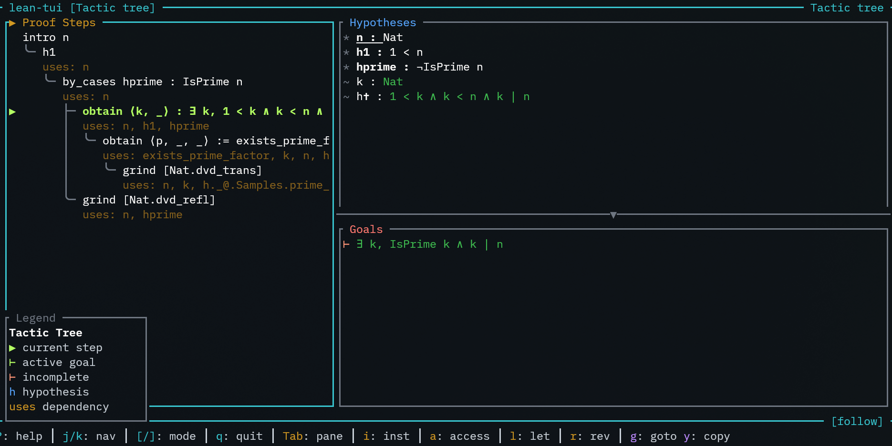
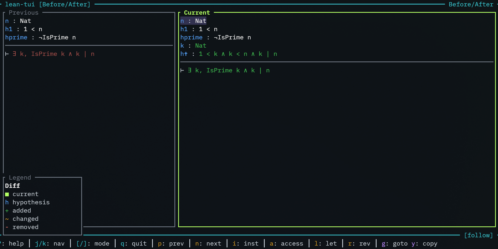
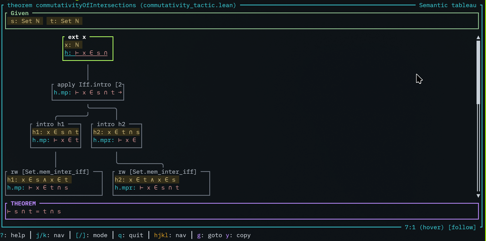
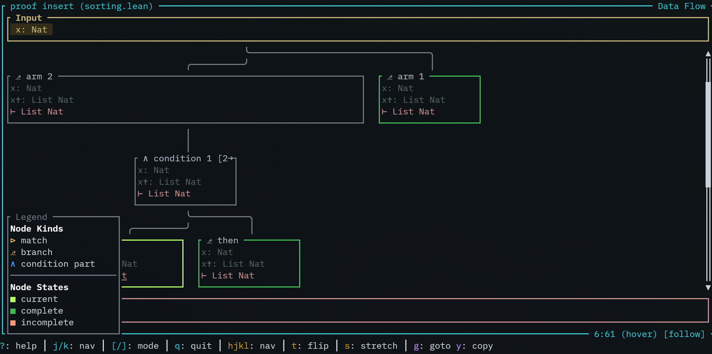
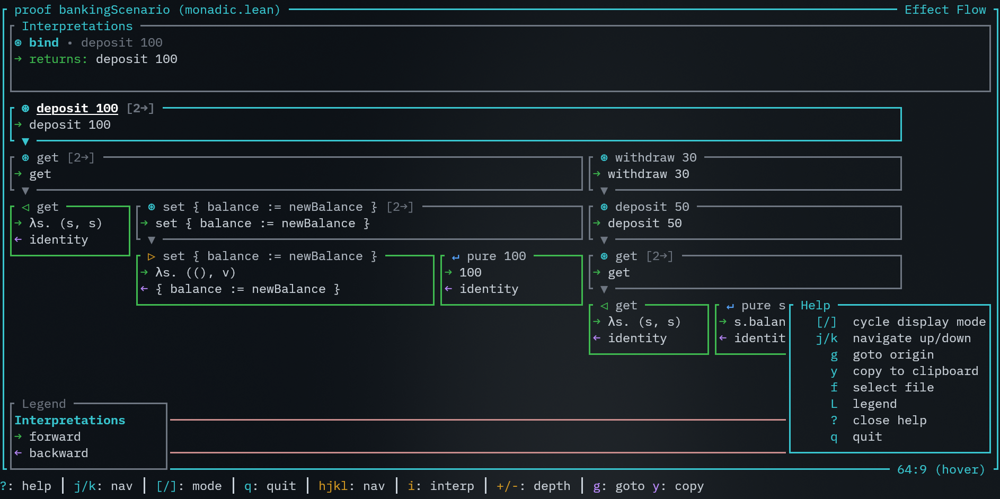

# Lean-TUI

**Standalone interactive view that shows a graph view of proofs that are written in [Lean](https://lean-lang.org/).**

Shows proof structure, hypotheses, and goals (comparable to the VS Code Web-based info view but in your terminal). However, this info view can also show the **complete graph structure** of the complete proof, not only the current open goals. It also tracks your edits in editor and reversely you can use the info view to jump to locations in the editor.

## Example

Below you can see (or go to [Codeberg](https://codeberg.org/wvhulle/lean-tui)) a simple but incomplete Lean proof:

```lean
import Mathlib.Data.Set.Basic

theorem commutativityOfIntersections
    (s t : Set Nat) : s ∩ t = t ∩ s := by
  ext x
  apply Iff.intro

  intro h1
  rw [Set.mem_inter_iff, and_comm] at h1
  exact h1

  intro h2
  rw [Set.mem_inter_iff, and_comm] at h2

  -- exact h2
```

This program will visualize the (incomplete) proof state by querying the Lean run-time and displaying with one of the following styles:

| Linear                       | Graph                            |
| ---------------------------- | -------------------------------- |
|     |       |
|  |  |

Linear modes do not show much proof structure:

- Plain list: simplest display mode with just a list of open goals
- Before after: current active goal state and previous and next goal state

If you are interested in your proof as it evolves (like a directed acyclic graph), use one of these:

- Tactic tree: tree of the tactic structure next to active hypotheses and goals
- Semantic tableau: proof shown as a semantic tableau

There are display modes focused on functional programming:

| Pure                       | Monadic                 |
| -------------------------- | ----------------------- |
|  |  |

I split them into:

- Data flow: for normal functional programs. It shows a graph of the local bindings and expected types throughout the program (but not yet supporting all control flow)
- Effect flow: inspired by [Aeneas](github.com/AeneasVerif/aeneas) and separation logic. Shows how effects by monadic computations affect forwards (returning new data) and backwards (modify existing state) computation direction. This is fairly new and a work-in-progress.

Try it out by opening one of the samples in [`samples/`](./samples).

## Installation

### 1. Install `lean-tui` from Crates.io

Install Rust (through [`rustup`](https://rustup.rs/)) if you haven't compiled Rust programs before. Then install this crate as a binary in your user with:

```bash
cargo install lean-tui
```

If `~/.cargo/bin` is in your path, you can now run this program with `lean-tui`.

### 2. Add `LeanDag` Dependency

Add [LeanDag](https://codeberg.org/wvhulle/lean-dag) as a Lake dependency.

In your `lakefile.toml`:

```toml
[[require]]
name = "LeanDag"
git = "https://codeberg.org/wvhulle/lean-dag.git"
rev = "main"
```

Fetch the source code of the latest version (Lean only hosts on Git, does not provide prebuilt dependencies):

```bash
lake update LeanDag
```

Add this to the top of your Lean file (or build target):

```lean
import LeanDag
```

## Configuration

Configure your editor to use `lake serve` as the Lean LSP server. This connects to lean-dag which provides the extended RPC methods.

For example, for Helix:

```toml
# .helix/languages.toml
[language-server.lean]
command = "lake"
args = ["serve"]

[[language]]
language-servers = ["lean"]
name = "lean"
```

## Usage

### 1. Split Your Terminal

You can choose between:

- Using multiple terminals (emulator windows) side-by-side (a terminal app is typically provided on Windows/Linux/Mac)
- Using a single terminal window with a terminal multiplexer (you'll need to install `zellij` or `tmux` with your system package manager)

Open your Lean file in your favorite (modal) editor that has a built-in LSP client (I recommend Helix, but Neovim, Zed, Kate also seem to have one).

Split terminal. Launch the TUI in same directory in the second terminal with `lean-tui`.

### 2. Start Writing Proofs

Switch back to your editor:

1. Move your cursor somewhere in a proof or function
2. Type in a proof or hover over tactics (`space,k` in Helix)

### 3. Play with Lean-TUI

Switch to the TUI. Key bindings:

| Key   | Action                          |
| ----- | ------------------------------- |
| `↑/↓` | Navigate hypotheses and goals   |
| `g`   | Go to where item was introduced |
| `y`   | Copy to clipboard (OSC 52)      |
| `[/]` | Switch display mode             |
| `?`   | Help menu                       |
| `q`   | Quit                            |
| `f`   | File selection                  |

The TUI follows your cursor in the editor automatically.

## Why?

For the **VS Code users**: I don't like VS Code and vendor lock-in, but I like the LSP protocol. The LSP protocol allows programmers to pick whichever editor they like. This means programmers (and mathematicians) will never be stuck with any big company.

For **[Paperproof](https://github.com/Paper-Proof/paperproof) users**: Paperproof was a big inspiration for this. However, it is Web-based. I used their approach to move most of the logic into Lean and add an RPC method there.

For the **Neovim users**, yes there existed an info view [Lean plugin for Neovim](https://github.com/Julian/lean.nvim) already, but not yet for the other terminal editors (Zed, Kakoune, Helix, ...) since the Lean plugin relies on Neovim specific features. It is not a generic one.

The `lean-dag` LSP server and this front-end is my attempt at a more generic one, not bound to any editor in particular, and usable from any terminal window.

Let me know if you tried it out and encountered any issues! PRs are also welcome.
